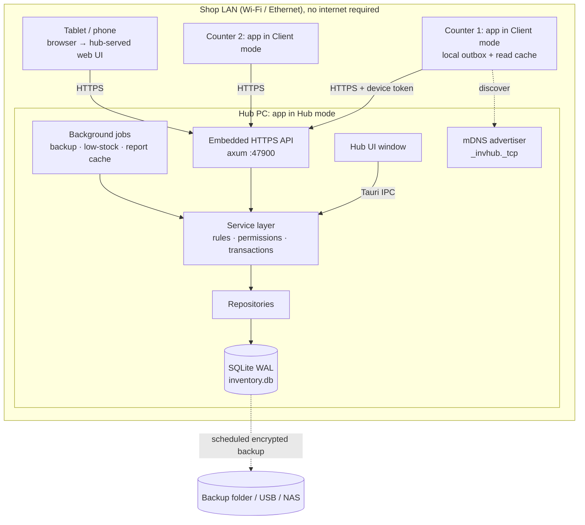
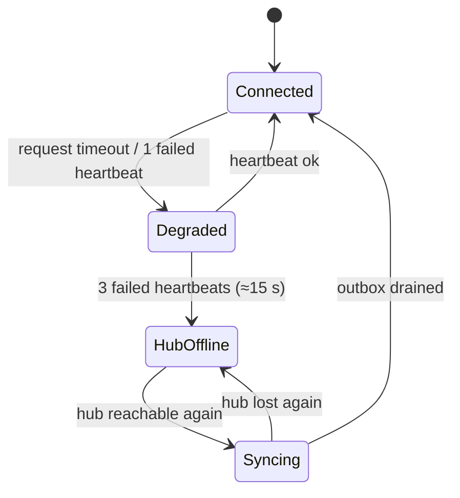
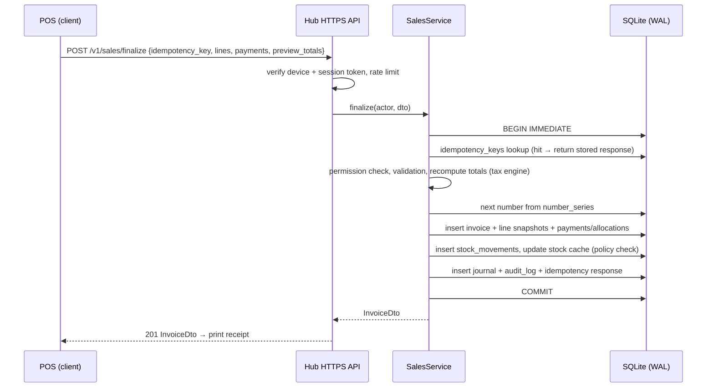

# Architecture: Offline-First, Multi-User Inventory + Billing

*Status: proposal from Phase 0, to be implemented in Phases 1–4. Decisions marked **[D-n]** are referenced from code comments and from [ASSUMPTIONS.md](ASSUMPTIONS.md).*

## 1. Problem

A shop has 1–10 devices: billing counters, a back-office PC, a manager's laptop, sometimes a tablet or phone. They must:

- share **one** stock position and **one** set of invoice numbers;
- keep working with **no internet**, and degrade gracefully when the local network blips;
- never oversell or duplicate a number without a deliberate, visible policy;
- be installable and supportable by non-technical owners.

## 2. Options evaluated

The Master Prompt describes Option A in detail and leaves Option B undescribed. I define Option B as the usual alternative, **multi-master local-first sync**: every device has a full database and changes are merged peer-to-peer or via a relay.

| Criterion | **A: LAN hub (single writer)** | B: multi-master sync (every device writes locally, merge later) |
|---|---|---|
| Stock correctness | ✅ One transaction per sale on one DB, so "last unit" races are impossible. | ⚠️ Two counters can sell the last unit while partitioned. Needs compensation (negative stock, back-orders). |
| Invoice numbering | ✅ Gapless, sequential per series. Legally simplest (GST/VAT). | ⚠️ Needs per-device series or later renumbering. Renumbering is not allowed for issued tax invoices. |
| Conflict handling | Only for queued client writes while the hub is unreachable (rare, small). | Every table needs merge rules (CRDTs or LWW + domain rules). Large ongoing complexity. |
| Works with no internet | ✅ Only the LAN is needed. | ✅ Works even with no LAN. |
| Works if the hub PC is off | ⚠️ Clients enter offline mode (outbox, with limits). | ✅ Fully. |
| Implementation and test effort | Moderate: HTTP API + outbox. | High: sync engine, merge tests, schema evolution across peers. |
| Supportability | One DB to back up, one place to look. | N copies that can diverge. Harder support. |
| Fits SMB hardware | ✅ Any Windows PC can be the hub. | ✅ |

### Decision **[D-1]**: Option A, LAN hub

Correctness of money, stock and legal numbering matters more than writing while partitioned. Most SMBs have a stable shop LAN and a PC that is on during trading hours. Option A gives a single source of truth with ordinary ACID transactions, the most "simple, boring, reliable" design (Master Prompt §16). The hub-offline case is covered by a narrow, policy-controlled outbox (§6), not by a general sync engine.

Option B is not ruled out for later. Branch-to-branch replication over the internet could reuse the `sync_outbox` / `sync_log` tables, and that is listed as a future suggestion only.

## 3. Topology



- **One binary, three modes [D-2]:** `standalone` (single PC, IPC only, which is today's behaviour and the default), `hub` (IPC + LAN API), and `client` (no local master DB; talks to a hub). The mode is chosen in onboarding and stored in device-local config (not in the shared DB).
- **Discovery:** clients connect to a configured IP or hostname. As a bonus, the hub advertises `_invhub._tcp` over mDNS (`mdns-sd` crate), so onboarding can list the hubs it finds. The pinned certificate (§7) is what authenticates the hub, not the mDNS answer.
- **Tablets and phones** use the same React build, served as static files by the hub's HTTP server. They are online-only clients: no outbox in the browser in v1 **[D-3]**.

## 4. Backend structure (Rust)

```
src-tauri/src/
  main.rs / lib.rs          bootstrap: config, logging, db pool, mode → start IPC and/or HTTP
  config/                   device config (mode, hub URL, device id/token), env profiles
  domain/                   pure types and logic, no I/O
    money.rs                Money(i64 minor units) + Currency, rounding modes
    qty.rs                  Qty(i64 scaled by 1000) fixed precision
    tax.rs                  tax engine: inclusive/exclusive, groups (CGST+SGST / IGST / VAT / none)
    numbering.rs            series formatting (prefix, FY, padding)
    valuation.rs            FIFO / weighted average
    error.rs                AppError { code, message, details }, with stable error codes
    enums.rs                Role, Permission, DocStatus, PaymentMode, MovementType, …
  db/
    pool.rs                 r2d2 + rusqlite, WAL, busy_timeout, foreign_keys=ON on every conn
    migrations/             0001_init.sql, 0002_… (embedded, tracked in schema_migrations)
  repo/                     SQL only, one file per aggregate (products.rs, sales.rs, stock.rs, …)
  services/                 use-cases: sales.rs (create/finalize/void/return), purchases.rs, stock.rs,
                            parties.rs, payments.rs, settings.rs, auth.rs, backup.rs, reports.rs
                            each takes (&Actor, Input DTO) → runs in one Tx with an idempotency key
  api/
    ipc.rs                  #[tauri::command] wrappers: deserialize → service → serialize
    http/                   axum router: the same DTOs and services; auth middleware; rate limit
    dto.rs                  request/response structs (#[derive(Serialize, Deserialize, specta::Type)])
  jobs/                     scheduler (tokio intervals): backups, low-stock, session cleanup, report cache
  telemetry/                tracing + rolling file logs, diagnostics bundle export
```

Rules:

- **No business logic in `api/` or in React.** Commands and routes only authenticate, decode and delegate.
- **Every write use-case** = `BEGIN IMMEDIATE` → permission check → validation → domain computation (the backend recomputes totals from lines) → writes (document + lines + stock movements + journal + audit) → `COMMIT`. **[D-4]**
- **Idempotency [D-5]:** every mutating request carries a client-generated `idempotency_key` (UUIDv7). The table `idempotency_keys(key, actor, request_hash, response_json, created_at)` is written in the same transaction. A retry returns the stored response and never re-applies the write.
- **Typed contract [D-6]:** DTOs derive `specta::Type`. `tauri-specta` generates `packages/shared/src/generated/api.ts` (command signatures + types), and the HTTP routes use the same DTOs. An OpenAPI document for the HTTP surface is generated with `utoipa`. CI fails if the generated files are stale.

## 5. Concurrency and the database on the hub

- SQLite in **WAL** mode, `synchronous=NORMAL` (FULL for the finalize-invoice path is evaluated in Phase 4 benchmarks), `busy_timeout=5000`, `foreign_keys=ON`.
- A pool of about 4 read connections plus writes serialized through `BEGIN IMMEDIATE`. That is enough for about 10 counters, since an invoice save is a single short transaction (target < 300 ms, Master Prompt §12).
- Password hashing (Argon2id) runs on a blocking thread **outside** any DB lock.
- Document numbers come from `number_series` rows, incremented inside the same write transaction. They are gapless per series.

## 6. Client mode, the outbox, and offline policy



- **Heartbeat** every 5 s (`GET /health` returns hub time, schema version, settings version). The UI always shows **Hub connected / Syncing (n) / Hub offline / Standalone** in the top bar.
- **Read cache:** clients cache the product catalogue, prices, tax rates, customers and settings in a small local SQLite (`client_cache.db`), refreshed incrementally by `updated_at` cursors. POS search therefore stays instant even when the hub is slow.
- **Outbox [D-7]:** while the hub is offline, permitted writes are stored locally in `sync_outbox(id, idempotency_key, kind, payload_json, created_at, device_seq, status, last_error)`. They are drained **in order** when the hub returns, and every submission is idempotent. Outcomes go to `sync_log`. Rejected items (for example the product no longer exists) show in a "Sync issues" panel for a manager.
- **Offline sales policy** (setting `network.offline_sales_policy`) **[D-8]:**
  - `block`: no sales while the hub is offline (safest; the default for multi-counter shops with batch or serial stock).
  - `allow_reserved_numbers` (**default**): each client device leases a **block of invoice numbers** from a device-specific sub-series (for example `C2-25/26-000101…000150`) while online. Offline invoices use the lease, so numbers stay unique and sequential *per series*, and that is legally fine because each series is an independent sequence. Stock is decremented on the hub at sync time. If that would push stock negative, the movement is still recorded and the item is flagged in an **oversell report** (the sale already happened physically and must not be refused retroactively).
  - `allow_restricted`: like the above, but items whose cached stock ≤ a threshold, or batch-tracked items, cannot be sold offline.
- Sensitive actions **never queue offline**: voids, returns, price-list edits, user and settings changes, stock-takes, manager approvals. They require a live hub.
- **Clock skew [D-9]:** the hub's clock is authoritative. Clients send their device time plus a monotonic `device_seq`, the hub stores both, and the business date of offline invoices is the client's local date at the time of sale (validated to be within ±24 h of hub time, otherwise flagged).

## 7. Security model on the LAN

- **Device pairing [D-10]:** a new client is paired by entering a 6-digit code shown on the hub (valid for 5 min). The hub issues a **device credential** (random 256-bit token, stored hashed in `devices`) and the client stores it in the OS keychain (`keyring` crate). Every request carries the device token **and** a user session token. A device can be revoked from the hub.
- **Transport [D-11]:** HTTPS with a hub-generated self-signed certificate (`rcgen`). The certificate fingerprint is pinned on the client at pairing time. No plain HTTP except a redirect. The API binds only to private-range interfaces, with a configurable allow-list of subnets.
- **Users:** Argon2id passwords, optional 4–6-digit PIN for quick cashier switching (PIN valid only on a paired device plus an active till), lockout after N failures with backoff, idle auto-lock.
- **Permissions** are enforced in `services/` against the `roles` → `permissions` tables. The UI hides what you can't do but never decides it.
- **Manager approval:** a sensitive action returns `APPROVAL_REQUIRED`, and a manager authorizes it on the same screen with their PIN. The approval is recorded in `audit_log` with both actors.
- **Rate limiting** on login and PIN endpoints (per device + user).

## 8. Background jobs (hub only)

| Job | Default schedule | Notes |
|---|---|---|
| Backup | Daily at day close + every 4 h during trading | SQLite online backup → zstd → AES-256-GCM (key derived from the owner's backup passphrase) → `backups/`. Rotation: 7 daily, 4 weekly, 12 monthly. Optional second copy to a USB or NAS path. |
| Integrity check | Weekly | `PRAGMA quick_check` + stock cache vs ledger verification. Mismatches are reported, never silently fixed. |
| Low-stock and expiry scan | Hourly | Writes notifications that the dashboard reads. |
| Report cache | Nightly | Daily summary tables for fast one-year reports. |
| Session and idempotency cleanup | Daily | |

## 9. Frontend architecture

```
packages/shared/            (TS) generated API types, Zod schemas, money/tax/qty utils mirrored from Rust
src/
  api/client.ts             one typed client: transport = TauriIpc | Http(hubUrl); retries + idempotency keys
  api/hooks/*.ts            TanStack Query hooks per domain (useProducts, useCreateInvoice, …)
  stores/                   Zustand for UI-only state (POS cart draft, layout, connection status)
  features/<module>/        pages + components per module (pos, sales, inventory, purchases, parties, …)
  components/ui/            shadcn primitives (kept)
  components/data-table/    TanStack Table + Virtual, column toggles, saved views, export
  lib/                      formatting (Intl, currency from settings), keyboard shortcut manager
```

- The **cart is UI state, but totals are previewed** with the shared TS tax engine. The backend recomputes them and rejects a request if its preview differs by more than 0 minor units (a mismatch means a bug, so it is surfaced, not silently accepted).
- Connection status comes from a small store fed by the heartbeat (client mode) or is always "Standalone/Hub" (hub mode).

## 10. Sequence: finalize a sale from a client counter



## 11. What changes from today

| Today | Target |
|---|---|
| One `Mutex<Connection>`, no WAL | Pool + WAL + `BEGIN IMMEDIATE` writes |
| 78 untyped commands, logic in commands and React | Thin `api/` → `services/` with typed DTOs and generated TS |
| Floats, client totals | `Money(i64)`, `Qty` fixed-point, backend-computed totals |
| `COUNT(*)+1` numbers | `number_series` (branch × doc type × FY), leased sub-series for offline clients |
| Mutable invoices | Immutable finalized docs with snapshots. Void, credit note, return. |
| `stock` column only | `stock_movements` ledger + verifiable cache |
| Single device | Standalone / Hub / Client modes over HTTPS on the LAN, with mDNS discovery |
| Manual backup path | Scheduled, encrypted, rotated, verified backups and a tested restore |

## 12. Implementation status (Phase 4)

Built as designed in §3–§8, with these differences (each recorded in ASSUMPTIONS.md):

| Design | As built | Why |
|---|---|---|
| `specta` / `utoipa` contract (D-6) | `schemars` JSON schema → `json-schema-to-typescript`; the same schema documents the HTTP surface (A-38) | Stable crates; one contract for IPC and HTTP. |
| Client `client_cache.db` with incremental cursors | `client.db`: full catalogue snapshot every 15 min (A-52), cached sessions, leases, outbox | Simpler; incremental sync is a Phase 7 item. |
| Tablets via hub-served UI (D-3) | HTTP API ready; serving the UI and browser pairing deferred to Phase 5 (A-47) | The screens still run on v1. |
| Offline sales policy (D-8) | As designed, plus: offline sales must be fully paid and need no manager (A-48) | The hub can't check credit or PINs while offline. |
| Backup key from the owner's passphrase | As designed; until a passphrase is set backups are not encrypted (A-53) | Not blocking the first sale. |

Code map: `src-tauri/src/hub` (HTTPS server, TLS identity, mDNS), `src-tauri/src/client` (counter runtime,
pinned HTTPS client, offline handlers, local store), `services/devices.rs`, `services/sync.rs`,
`services/backup.rs`, `jobs.rs`, `node.rs` (device role), `secrets.rs` (OS keychain),
`api/local.rs` (commands about this PC). In client mode `lib.rs::route` forwards every v2 command to the hub
unchanged, so screens don't know which mode they run in.
