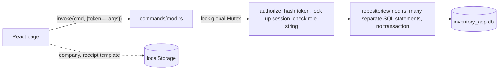

# Phase 0 Audit: Inventory + Billing App

*Audit date: 2026-10-17 · Baseline commit: `d38c517` · Scope: the whole repository (`src/`, `src-tauri/`, config). No code was changed in this phase.*

All paths are relative to the repository root. Line numbers refer to the baseline commit.

---

## 1. Summary

The app is a working **single-user desktop prototype**. It has a wide feature surface (POS, invoices, quotations, purchase orders, CRM, double-entry journals, reports, users, backup), and both builds pass. It is **not safe to use with real money and stock yet**. The main reasons:

1. **No database transactions.** Every multi-step write (sale, purchase receipt, payment, edit, cancel) runs as separate statements. One failure halfway leaves stock, balances and the ledger out of step with each other.
2. **Money is stored as floating-point numbers, and the client calculates the totals.** The backend stores whatever subtotal, tax and total the screen sends.
3. **Billing has several logic errors that corrupt the books.** Overpayments are saved as negative dues and produce unbalanced journals. Credit sales are saved as paid. Invoices can be cancelled twice. Finalized invoices can be edited freely and have no snapshot of what was sold.
4. **Invoice numbers come from `COUNT(*) + 1`.** With more than one writer this produces collisions. There is no numbering series per branch or financial year.
5. **Security is demo-grade.** A default admin password is seeded and shown on the login screen. There is no lockout or rate limiting. Backup and restore accept arbitrary file paths. CSP is disabled.
6. **The design is single-device.** One `Mutex<Connection>` sits inside one Tauri process. There is no network layer, no outbox and no schema-migration history.

The rebuild should keep the stack choices (Tauri 2 + Rust + SQLite, React + Vite + Tailwind + shadcn, TanStack Query, Zustand). It should replace the data model, the service layer and most page components.

### Build status at baseline

| Check | Result |
|---|---|
| `npm run build` (Vite 7) | ✅ passes. One JS chunk is **1.72 MB** (510 kB gzip): no code splitting, and the whole `@hugeicons` set plus `xlsx` are bundled. |
| `cargo check` (src-tauri) | ✅ passes, no errors. |
| Type checking | ❌ none. The frontend is plain JS (`jsconfig.json` only). |
| Lint / format / tests / CI | ❌ none exist. |
| Version control | ❌ there was no git repo. Phase 0 initialized one and committed a baseline. |

---

## 2. Current stack and structure

| Layer | Technology |
|---|---|
| Desktop shell | Tauri 2 (`src-tauri/tauri.conf.json`), plugin `opener` only |
| Backend | Rust 2021: `rusqlite 0.31` (bundled, `backup` feature), `argon2 0.5`, `uuid` v4, `chrono`, `sha2`, `rand` |
| Database | One SQLite file, `%LOCALAPPDATA%\com.niyas.tauri-app\inventory_app.db` (`src-tauri/src/database/mod.rs:12-22`). Default journal mode (not WAL). |
| Frontend | React 19, Vite 7, react-router 7, Tailwind 4, shadcn (base-ui), Hugeicons and Lucide (two icon sets), recharts, sonner, xlsx, react-barcode, react-qr-code |
| State | Zustand (`src/hooks/use-store.js`): auth, POS cart, held orders, notifications, currency. TanStack Query is used by only 3 hook files. |
| Installed but unused | `zod`, `react-hook-form`, `next-themes` (partly), `embla-carousel`, `input-otp`, `vaul`, `react-resizable-panels`, `cmdk` (only through shadcn), `shadcn` (a CLI in `dependencies`) |

```
src/
  App.jsx                 routes (POS sits outside the auth layout)
  app/layout.jsx          auth guard + sidebar + breadcrumbs
  app/auth.jsx            login page
  hooks/use-store.js      global Zustand store (auth + POS + alerts)
  hooks/tanstack/*.jsx    useProducts, useCategories/Brands, useUnits
  components/ui/*         ~60 shadcn primitives
  components/sidebar/*    navigation
  pages/<module>/*.jsx    ~30 pages, 100–780 lines each, all JS
src-tauri/src/
  lib.rs                  registers 78 commands
  commands/mod.rs         1,347 lines: auth check + arg plumbing (+ some business logic)
  repositories/mod.rs     3,038 lines: ALL SQL and business logic
  models/mod.rs           serde structs
  auth/mod.rs             Argon2id hashing, session tokens (SHA-256)
  database/migrations.rs  CREATE TABLE IF NOT EXISTS + ad-hoc ALTERs + seed data
```

### Data flow today



- The session token sits in `localStorage` (`use-store.js:7,16`) and is passed as an argument on every command.
- Every command locks the single connection, so all requests are serialized, including the 64 MB Argon2 hash during login (`auth/mod.rs:11`, `commands/mod.rs:37-42`).
- Business rules are split between React (totals, tax, discount, stock checks) and Rust (stock mutation, journals).

---

## 3. Feature and module matrix

| Module | Page(s) | Status | Notes |
|---|---|---|---|
| Login / session | `app/auth.jsx`, `login-form.jsx` | Partial | Works. Demo credentials are prefilled. No lockout, no PIN switching, 8 h fixed expiry. |
| Dashboard | `dashboard/Overview.jsx` | Partial | Totals are all-time and include cancelled invoices. **Fails silently for the `staff` role** (stats command denies staff, `commands/mod.rs:739`). The `/dashboard/reports` sidebar link has no route. |
| Products | `inventory/Products.jsx`, `AddEditProduct.jsx` | Mostly complete | Server-side pagination and search. Excel import and template. Product history is wrong (see B-11). No variants, batches or multiple warehouses. |
| Categories / brands / units | `inventory/Categories.jsx` | Complete (basic) | Soft delete. No unit conversions. |
| Stock adjustments | `inventory/Adjustments.jsx` | Partial | ADD / SUBTRACT / SET with a reason. No approval. Allows negative stock. Loads every product. |
| Barcodes | `inventory/Barcodes.jsx` | Partial | Renders barcodes and prints through the browser. No label-printer support. |
| POS | `sales/POS.jsx` | Partial / buggy | Works for simple cash sales. Overpayment, credit and edit flows are wrong (B-4, B-5). No auth guard. |
| Invoices | `sales/Invoices.jsx` | Partial / buggy | List, filter, "status" changes, edit in POS. Cancelling can be repeated. "Paid" status records no payment. |
| Quotations | `sales/Quotations.jsx` | **Broken (convert)** | Create works. **Convert to invoice always fails** (B-9) and has no "converted" state. |
| Sales returns / credit notes | `sales/Returns.jsx` | **Stub** | Static empty state only. |
| Purchase orders | `purchases/Orders.jsx` | Partial | Draft, then receive (weighted-average cost). No partial receipt, no bill or payment link. |
| Purchase bills | `purchases/Bills.jsx` | Partial | A filtered view of received POs. Not a real bill. |
| Purchase returns | `purchases/Returns.jsx` | **Stub** | |
| Customers / suppliers | `contacts/*.jsx` | Partial | CRUD. **The outstanding balance is a free-entry field** (`Customers.jsx:369`, `Suppliers.jsx:354`), which bypasses the ledger. No statements. |
| Leads | `contacts/Leads.jsx` | Complete (basic) | Pipeline CRM. Not in the target scope but kept (see ASSUMPTIONS). |
| Payments in / out | `accounting/PaymentsReceived.jsx` | **Broken** | `create_payment_cmd` exists but **no screen calls it**. The page only lists invoices. Receivables cannot be collected properly. |
| Expenses | `accounting/Expenses.jsx` | Partial | Always credits cash. Account picked by `category.contains("rent")` (`repositories/mod.rs:1530`). Delete leaves the journal entry behind (`:1581`). |
| Chart of accounts / journals | `accounting/*.jsx` | Partial | Manual journals checked for balance with float tolerance. No period lock, no reversal. |
| Taxes | `accounting/Taxes.jsx` | Partial | One flat rate per product. No groups (CGST/SGST/IGST), no inclusive pricing. Tax is not posted to a liability account. |
| Reports | `reports/*.jsx` | **Mostly broken** | P&L COGS is always 0 (B-10). Two of the four report tabs link to routes that don't exist (`/reports/sales-summary`, `/reports/tax-summary`, e.g. `ProfitAndLoss.jsx:77,91`). No date range, no export. Tax report groups by date, not by rate. |
| Settings: company / preferences / templates | `settings/*.jsx` | Partial | Stored in `localStorage` or memory only (`Company.jsx:23-35`, `Templates.jsx:25`). Currency resets on restart. Receipts don't use them (hardcoded "Offline Billing Store", `POS.jsx:704`). |
| Users | `settings/Users.jsx` | Partial | Create, edit, delete. No password reset. The role is an unchecked free string on the backend. |
| Backup / restore | `settings/Maintenance.jsx` | Partial / unsafe | A typed-in file path. No schedule, encryption, validation or rotation. |
| Audit log | dashboard widget | Partial | Covers CRUD actions. Last 100 rows. Not append-only (an ordinary table). |
| Multi-user / LAN / offline sync | — | **Missing** | |

---

## 4. Bugs, logic errors, race conditions, edge cases

| ID | Severity | Finding | Location | Impact |
|---|---|---|---|---|
| B-1 | Critical | **No transactions** in `create_invoice`, `update_invoice`, `create_purchase`, `receive_purchase`, `create_payment`, `create_expense`, `create_journal_entry`, `adjust_stock`, `update_invoice_status_cmd`. Only `bulk_import_products_cmd` uses one. | `repositories/mod.rs:1025,1336,1502,1587,1768,2053,2137`; `commands/mod.rs:1002` | A failure halfway (FK error, missing account code, crash) leaves stock reduced with no invoice row, or an invoice with no journal, and so on. |
| B-2 | Critical | Money and quantities are `REAL` (f64) throughout. Totals, tax and discount are computed in JS and **accepted as-is** by the backend. | `migrations.rs:79-82,198-203`; `POS.jsx:137-139`; `commands/mod.rs:532-559` | Rounding drift (₹0.01 errors add up in reports). A modified or buggy client can post any total. |
| B-3 | Critical | Document numbers are `COUNT(*)+1` (`INV-000001`, `QT-…`, `PO-…`). | `repositories/mod.rs:1038,1236,1345` | Duplicate numbers (UNIQUE violation, failed sale) as soon as two writers exist or rows are hard-deleted. No series per branch or FY. Gaps are not controlled. |
| B-4 | Critical | **POS overpayment**: the tendered amount is saved as `amount_paid`. When it exceeds the total, `due_amount` goes negative, the customer's due **decreases** by the change given, and the journal debits cash by more than it credits revenue (unbalanced). | `POS.jsx:532-543,227`; `repositories/mod.rs:1043-1127` | The books stop balancing. Customers silently get credit equal to their change. |
| B-5 | Critical | **CREDIT sales recorded as paid**: `amountPaid` is auto-set to the net total (`useEffect`) and the input is hidden for CREDIT, so `amountPaid = total` is sent. | `POS.jsx:141-143,521` | Receivables are understated and cash is overstated. |
| B-6 | Critical | Cancelling an invoice is not idempotent. Every "Cancel" adds the stock back again and reduces the customer due again. The journal is never reversed, and the revenue queries don't exclude `Cancel`. | `commands/mod.rs:1025-1050`; `repositories/mod.rs:1901-1953` | Phantom stock. Revenue, profit and tax reports are inflated. |
| B-7 | Critical | **Finalized invoices are mutable and have no snapshot.** `get_invoice` joins live `products`/`tax_rates`, so a later rename or tax change rewrites old invoices. `update_invoice` deletes and re-creates items and **deletes the original journal**. | `repositories/mod.rs:1135-1190,2137-2277` | Not legally compliant (GST / VAT invoices must be immutable). History cannot be audited. |
| B-8 | Critical | **Negative stock** is allowed. The only check is in the client cart (`use-store.js:81,92`). `adjust_stock` SUBTRACT and invoice creation never check. | `repositories/mod.rs:612-657,1076-1079` | Overselling, with negative valuation feeding weighted-average cost (clamped to 0 in `receive_purchase` at `:2081`). |
| B-9 | High | Quotation → invoice conversion calls `JSON.parse(quote.items)`, but `items` is an array (and empty in list results), so it always throws. The convert also sends `tax: 0`, assumes it was paid in cash, and never marks the quotation as converted. | `Quotations.jsx:93,110-120` | The feature doesn't work. If fixed naively, the same quote can be converted many times. |
| B-10 | High | P&L COGS uses `JSON.parse(inv.items)` on list results that contain no items, so it is always 0. The backend COGS uses the **current** product cost rather than the cost at the time of sale. | `ProfitAndLoss.jsx:51-58`; `repositories/mod.rs:1944-1952` | Wrong profit. Historical profit changes whenever a cost changes. |
| B-11 | High | Product history double-counts sales: it unions `invoice_items` **and** the `stock_adjustments` rows written for the same sale. SET adjustments show as +qty. Cancelled invoices still appear as sales. | `repositories/mod.rs:2976-3037` | Misleading stock card. |
| B-12 | High | Role-name mismatch: `list_units_cmd` and `get_product_transactions_cmd` allow `"cashier"`, but the role is called `"staff"`. | `commands/mod.rs:1322,1344` | Staff cannot load units (product form) or product history. |
| B-13 | High | Marking an invoice "Paid" sets `amount_paid = total` but writes **no payment row and no journal**. The status is a free string (anything goes into `payment_status`). | `commands/mod.rs:1015-1024,1051-1056` | Cash book and AR disagree. |
| B-14 | High | Customer `due_amount` and supplier `balance` can be overwritten from the edit form. | `Customers.jsx:110,369`; `Suppliers.jsx:94,354`; `repositories/mod.rs:722-768` | The ledger is no longer the source of truth. |
| B-15 | High | Excel bulk import `ON CONFLICT(sku) DO UPDATE SET stock = excluded.stock` **overwrites the stock** of existing products, with no stock movement and only one aggregate audit row. | `commands/mod.rs:959-988` | Stock can be silently reset by an import. |
| B-16 | High | Recalling a held order doesn't delete it (the delete is commented out), so it can be recalled and sold twice. The held-order id comes from `Math.random`. | `use-store.js:175,205` | Duplicate sales. |
| B-17 | High | `stock_adjustments.adjusted_by` is a FK to users, but the repos insert `actor_id.unwrap_or("")`. | `repositories/mod.rs:1086,1386,2101,2169` | The FK fails if the actor is ever missing, and because there is no transaction the sale is left half-written. |
| B-18 | Medium | Editing an invoice in the POS checks quantities against current stock without adding back the invoice's own quantity. The tax rate is inferred from a ratio. | `POS.jsx:117-121,409-410` | Valid edits are blocked. Mixed-rate invoices get the wrong tax. |
| B-19 | Medium | Discount is applied **after** tax (`subtotal + tax - discount`). | `POS.jsx:139` | Wrong taxable value for GST and VAT. |
| B-20 | Medium | All dates use UTC (`Utc::now().format("%Y-%m-%d")`). | `repositories/mod.rs:1040,1897` etc. | Sales made between 00:00 and 05:30 IST fall on the previous day. "Today" is wrong. |
| B-21 | Medium | Deleting a category, brand, unit, customer or product is a soft delete, but `get_invoice`/`get_purchase` use `JOIN` (not `LEFT JOIN`) on customers and products. Hard-deleted or missing rows make old documents disappear. | `repositories/mod.rs:1140,1168,1429` | Old invoices can vanish from lists. |
| B-22 | Medium | Purchases: `create_purchase` checks `status == "RECEIVED"`, but the UI always sends `"PENDING"`. There is no partial receipt, no landed cost, and receipt can't be undone. | `repositories/mod.rs:1356`; `Orders.jsx:145` | Limited, though consistent. |
| B-23 | Medium | `create_journal_entry` returns `InvalidQuery` for unbalanced entries (an opaque error message). The float tolerance is 0.001. | `repositories/mod.rs:1787-1789` | Confusing error, and float-based balance checks. |
| B-24 | Low | Restore runs the SQLite backup API into the live connection with no schema or version check, and the app then calls `window.location.reload()`. | `commands/mod.rs:795-825`; `Maintenance.jsx:36-44` | Restoring an incompatible or foreign file corrupts the app state. |

---

## 5. Performance problems

| ID | Finding | Location | Fix |
|---|---|---|---|
| P-1 | A single `Mutex<Connection>` serializes every command, including Argon2 hashing at about 64 MB / 3 iterations. | `database/mod.rs:8`; `commands/mod.rs:37` | WAL + a connection pool. Hash outside the lock. |
| P-2 | The POS, Quotations, Orders, Adjustments, Barcodes and StockValuation pages call `list_products_cmd` (**all** products, 4 joins) and filter or sort in JS on every keystroke. | `POS.jsx:78,264-273`; `Orders.jsx:71`; etc. | A server-side indexed search endpoint (prefix + FTS5), debounced, with limit 20. |
| P-3 | Low-stock alerts load every product after every login and create one notification per product. | `use-store.js:242-262` | A `COUNT` query or a materialized flag. |
| P-4 | N+1 queries: `list_payments` runs one query per row for the entity name. `list_journal_entries` prepares and runs one query per entry. | `repositories/mod.rs:1689-1719,1852-1891` | JOIN / batched `IN` query. |
| P-5 | `LIKE '%term%'` on name, SKU and barcode cannot use indexes. Exact barcode lookups also go through `LIKE`. | `repositories/mod.rs:537` | An exact-match index for barcode and SKU. FTS5 for names. |
| P-6 | Missing indexes on every FK and date column (`invoice_items.invoice_id`, `.product_id`, `invoices.date`, `.customer_id`, `stock_adjustments.product_id`, `journal_lines.journal_entry_id`, `audit_logs.timestamp`, …). Redundant indexes duplicate the UNIQUE ones (`idx_products_sku`, `idx_invoices_number`). | `migrations.rs:359-362` | Index design from query patterns (DATABASE.md, Phase 2). |
| P-7 | Reports aggregate all-time data with no date filter. P&L and Sales Summary also download every invoice to the client. | `repositories/mod.rs:1896-1965`; `ProfitAndLoss.jsx:37` | Date-ranged SQL aggregations. |
| P-8 | Double fetch on mount: two `useEffect`s both call `fetchData()` in Invoices, Quotations, Orders, Customers, Suppliers, Leads, Expenses. Pages also re-fetch customers and products every time a filter changes. | e.g. `Invoices.jsx:64-72`; `Quotations.jsx:76-84` | TanStack Query with stable keys. |
| P-9 | No list virtualization. The POS tile grid renders every product. | `POS.jsx:335` | TanStack Virtual. |
| P-10 | A 1.7 MB single bundle. The whole Hugeicons package is imported through `/index`, and `xlsx` is always loaded. | build output | Route-level `lazy()`, one icon set, dynamic import of `xlsx`. |
| P-11 | `useStore()` is destructured without a selector in the POS and Layout, so any store change (for example a notification) re-renders the whole POS. | `POS.jsx:31-46`; `layout.jsx:27` | Selectors / `useShallow`. |

---

## 6. Security problems

| ID | Severity | Finding | Location |
|---|---|---|---|
| S-1 | Critical | A default admin `admin@example.com / password123` is seeded on first run, **prefilled in the login form, and printed on the login screen**. Nothing forces a password change. | `migrations.rs:371-395`; `login-form.jsx:17-20,82-86` |
| S-2 | Critical | No account lockout, rate limit or failed-login audit (only successes are logged). Error messages are uniform, which is fine. | `commands/mod.rs:31-59` |
| S-3 | High | `backup_database_cmd` / `restore_database_cmd` take **arbitrary file-system paths** from the UI (`VACUUM INTO ?1`, `Connection::open(src)`). An admin session can write anywhere or load any SQLite file. Backups are unencrypted. | `commands/mod.rs:779-825` |
| S-4 | High | `"csp": null` with a `transparent` window. Any XSS (for example from an imported product name rendered unsafely in the future) would have full IPC access. | `src-tauri/tauri.conf.json:21-23` |
| S-5 | High | The session token is in `localStorage` and passed explicitly to every command. No idle timeout, no session revocation list in the UI, no per-device binding. | `use-store.js:7,16`; `repositories/mod.rs:199-210` |
| S-6 | High | Roles are free strings. `create_user_cmd` / `update_user_cmd` accept any role value. An admin can delete or demote themself and leave no admin. There are no fine-grained permissions and no manager approval for discounts, voids or price overrides. | `commands/mod.rs:98-137` |
| S-7 | High | No server-side validation: negative prices or quantities, discount > total, empty names, invalid emails, arbitrary `status` and `payment_type` strings are all accepted. | throughout `commands/mod.rs` |
| S-8 | Medium | The parameter named `password_hash` in `create_user_cmd` actually carries the plain password over IPC (it is hashed there, but the naming invites misuse). There is no password policy and no "change my password" flow. | `commands/mod.rs:103` |
| S-9 | Medium | The audit log is a normal mutable table. It doesn't record failed logins, discounts or price overrides, and it stores full JSON row dumps, including customer PII. | `migrations.rs:332-344` |
| S-10 | Medium | No encryption at rest. The DB file sits in `%LOCALAPPDATA%` and any OS user with access can read it. | `database/mod.rs` |
| S-11 | Low | `println!` of the DB path. Errors return raw rusqlite messages to the UI (leaking schema details). | `database/mod.rs:24`; every `map_err(e.to_string())` |
| S-12 | Low | The login page loads a remote image from `miro.medium.com`. It fails offline and leaks usage to a third party. | `src/app/auth.jsx:26` |
| — | OK | Passwords use Argon2id with sensible parameters. Session tokens are 256-bit random and stored as SHA-256. Every query is parameterized, and the dynamic `ORDER BY` uses whitelists. **No SQL injection found.** | `auth/mod.rs`; `repositories/mod.rs:571-583` |

---

## 7. Code quality

- **Giant modules:** `repositories/mod.rs` (3,038 lines) and `commands/mod.rs` (1,347 lines) mix every domain. Several pages are 400–780 lines with data fetching, business rules, forms and print layouts in one component (`POS.jsx` 782, `Products.jsx` 697).
- **Duplication:** eight copy-pasted `list_*_filtered` builders (`repositories/mod.rs:2279-2929`). Journal-posting code repeated in five places. The receipt markup duplicated in `POS.jsx` and `Invoices.jsx`. The settings tab header duplicated across five settings pages and the reports header across four.
- **Business logic in commands and UI:** `update_invoice_status_cmd`, `hold_order_cmd` and `bulk_import_products_cmd` contain raw SQL in the command layer. Pricing and tax logic lives in React.
- **Weak typing:** no TypeScript. Rust uses `String` for every enum (role, status, adjustment type, payment type). `is_expiry_tracked: i32` stands in for a bool. Errors are `String`, with domain errors mapped to `rusqlite::Error::InvalidQuery`.
- **Inconsistent data access:** a mix of TanStack Query hooks (products, categories, units) and ad-hoc `invoke` + `useState` everywhere else. Commands are invoked by string name with untyped args.
- **Dead code:** a commented-out `get_user_by_email` (`repositories/mod.rs:59-74`). Unused commands (`get_quotation_cmd`, `get_purchase_cmd`, `create_payment_cmd`, `list_payments_cmd`, `list_payments_filtered_cmd`, `list_expenses_cmd`, `list_quotations_cmd`, `list_leads_cmd`). Unused npm dependencies (§2). `src/assets/react.svg`, and `public/tauri.svg` / `vite.svg`.
- **Schema management:** no versioned migrations. `CREATE IF NOT EXISTS` plus column sniffing (`migrations.rs:429-454`). The `products` FK to `tax_rates` is declared before `tax_rates` exists (it works only because SQLite resolves FKs lazily).
- **No tests, linting, formatting, pre-commit hooks or CI.** Placeholder metadata (`authors = ["you"]`, `productName: "tauri-app"`, "Acme Inc." branding, demo team switcher in `app-sidebar.jsx:50-55`).

---

## 8. UX problems

- **The POS isn't keyboard-first.** The only shortcut is Enter-to-add-by-exact-SKU or barcode in the search box. There are no F-keys, no arrow-key row navigation and no quantity entry by keyboard. Customer selection is a native `<select>` over all customers. Payment is not a dialog, and split payments are missing despite the label (`POS.jsx:520`).
- `alert()` / `window.confirm()` are used for errors and confirmations across 18 pages (59 calls). They block the window and look non-native.
- Receipts print through `window.print()` of a modal, with no 58/80 mm templates, no company details and the **UUID prefix** in place of the invoice number (`POS.jsx:710`).
- The "Terminal Online (Offline-First)" badge is hardcoded (`POS.jsx:296-298`). There is no real connection status anywhere.
- No role-aware navigation. Staff see Accounting, Reports and Settings, then hit silent failures (the dashboard shows zeros for staff).
- Broken links: `/dashboard/reports`, `/reports/sales-summary`, `/reports/tax-summary`. All of them redirect to the dashboard without explanation.
- Errors are only logged to the console in most list pages (`catch (e) { console.error(...) }`), so the user sees an empty table. There are no skeletons (spinners only) and no undo.
- No global search (Ctrl+K), no saved views, no column toggles, no export on lists (only the product import template).
- Small-screen layout: the POS is a 7/5 grid with fixed `h-[60vh]` areas. Tablet use is cramped, and the notification bell does nothing (`layout.jsx:102-107`).
- No onboarding. First run lands on a login page that shows demo credentials.

---

## 9. Prioritized fix list

Effort: **S** ≤ 0.5 day · **M** 1–3 days · **L** 1–2 weeks. Most Critical and High items are addressed *by design* in the rebuild phases, not by patching the current code.

### Critical
| # | Fix | Refs | Effort | Phase |
|---|---|---|---|---|
| 1 | Run every multi-step operation inside a transaction with an idempotency key, at the service layer | B-1, B-17 | M | 3 |
| 2 | Integer minor-unit money and fixed-precision quantities. Server-side pricing, tax and rounding engine. The backend recomputes totals and rejects mismatches. | B-2, B-19 | L | 2–3 |
| 3 | `number_series` table with a locked increment inside the transaction, per branch, document type and FY | B-3 | M | 2–3 |
| 4 | Payment model: tendered vs applied vs change. Credit sales. Split payments. `payments` + `payment_allocations`. | B-4, B-5, B-13 | M | 5 |
| 5 | Immutable finalized invoices with line snapshots. Void / credit note instead of edit or cancel. Reversal journals. | B-6, B-7, B-10 | L | 2, 5 |
| 6 | `stock_movements` ledger as the source of truth. Negative-stock policy enforced in the backend. | B-8, B-11, B-15 | L | 2–3 |
| 7 | Remove the seeded default password. First-run onboarding creates the owner. Lockout and rate limiting. | S-1, S-2 | S | 3 |

### High
| # | Fix | Refs | Effort | Phase |
|---|---|---|---|---|
| 8 | A permission-based RBAC (roles → permissions table) checked in services. Enum-typed roles. Last-owner protection. | B-12, S-6 | M | 3 |
| 9 | Server-side validation of every input (typed DTOs) | S-7 | M | 3 |
| 10 | Backup and restore: fixed backup directory, schedule, encryption, rotation, integrity and schema-version checks, restore into a staging file followed by a restart | S-3, B-24 | M | 4 |
| 11 | Strict CSP. Remove the remote assets. | S-4, S-12 | S | 1 |
| 12 | Quotation → sales order / invoice conversion with status tracking | B-9 | S | 5 |
| 13 | Ledger-derived party balances (no manual edit). Opening balances as entries. | B-14 | M | 2, 5 |
| 14 | Held bills persisted server-side and removed on recall | B-16 | S | 5 |
| 15 | Settings stored in the DB (typed, validated, audited). Receipts use the business profile. | §3 settings | M | 6 |
| 16 | Fix the report routes. Date-ranged SQL reports with COGS at historical cost. | B-10, P-7 | M | 6 |
| 17 | WAL + a connection pool. Argon2 outside the lock. | P-1 | S | 3 |

### Medium
| # | Fix | Refs | Effort | Phase |
|---|---|---|---|---|
| 18 | Indexed product search endpoint (exact barcode/SKU + FTS5) | P-2, P-5 | M | 3 |
| 19 | Index design for FKs and dates. Drop the redundant indexes. | P-6 | S | 2 |
| 20 | Remove the N+1 queries | P-4 | S | 3 |
| 21 | Local-timezone business dates from settings | B-20 | S | 2–3 |
| 22 | Typed API client + TanStack Query everywhere. Kill the double fetches. | P-8, §7 | M | 1, 5 |
| 23 | Virtualized tables (TanStack Table + Virtual) | P-9 | M | 5, 7 |
| 24 | Typed errors with codes. Sanitized messages to the UI. | S-11, B-23 | S | 3 |
| 25 | Append-only audit log covering failed logins, discounts, overrides and settings | S-9 | S | 3 |
| 26 | Replace `alert`/`confirm` with dialogs and toasts. Add error and empty states. | §8 | M | 7 |

### Low
| # | Fix | Refs | Effort | Phase |
|---|---|---|---|---|
| 27 | Code splitting, one icon set, lazy `xlsx` | P-10 | S | 7 |
| 28 | Remove dead code, unused commands and deps. Fix the branding and metadata. | §7 | S | 1 |
| 29 | Role-aware navigation and broken-link cleanup | §8 | S | 5, 7 |
| 30 | Encryption at rest (SQLCipher), if it holds up on the target hardware | S-10 | M | 4 |

---

## 10. Recommended architecture (short)

The full rationale is in [ARCHITECTURE.md](ARCHITECTURE.md).

- **Option A, LAN hub.** One shop PC runs the app in **Hub** mode. It owns the only SQLite database (WAL) and exposes the same Rust service layer over an embedded HTTPS API on the LAN. Other counters run the same app in **Client** mode; tablets and phones use the hub-served web UI. All writes go through hub transactions, so stock and document numbers cannot conflict.
- Rust backend in layers: `api` (Tauri commands + HTTP routes, thin) → `services` (business rules, permissions, transactions) → `repo` (SQL) → `db` (pool, migrations). Plus `domain` (money, tax, quantities, enums, errors).
- Frontend: React + strict TypeScript + Vite, with a single typed API client whose transport is either Tauri IPC or HTTP. TS types are generated from the Rust DTOs, and Zod schemas are used for forms.
- Clients keep a small local outbox (idempotent commands) and a read cache, and follow a configurable offline policy.

---

## 11. Migration plan (no data loss)

The goal is to carry every existing record into the new schema and to be able to prove nothing was lost.

1. **Freeze and back up.** On the first launch of the new version, close all writers and copy `inventory_app.db` to `backups/pre-v2-<timestamp>.db` (checksum recorded). Then run `PRAGMA integrity_check` on the copy. Abort if it fails.
2. **Create the new database.** Create `inventory_v2.db` from versioned migrations (`schema_migrations`). The old file is never modified; it is kept read-only.
3. **ETL in one transaction** (old file attached as `legacy`):
   - Users: keep the Argon2 hashes. Map `admin→Owner`, `manager→Manager`, `accountant→Accountant`, `staff→Cashier`. Sessions are dropped, so everyone logs in again.
   - Master data (categories, brands, units, tax rates, customers, suppliers, leads, chart of accounts): keep the existing UUIDs as primary keys (v4 is accepted alongside new v7 IDs) and map `is_deleted=1` to `deleted_at`.
   - Products: `price`, `cost` and `offer_price` become integer minor units via `ROUND(x*100)`. Every value whose rounding changes it by more than 0.001 goes into a **rounding report**. One default branch and warehouse are created.
   - Stock: each product's current `stock` becomes one **opening-balance `stock_movement`** dated at migration time, so the cache equals the ledger. Legacy `stock_adjustments` are imported as historical, informational movements flagged `legacy` that are not re-applied.
   - Invoices, quotations, purchases: imported as **finalized legacy documents** that keep their original numbers. Line snapshots are back-filled from the current product, tax and customer data and flagged `snapshot_source='migrated'`. Cancelled invoices become `voided`. Number series start after the highest existing number.
   - Payments, expenses, journals: amounts become minor units. Each invoice's `amount_paid` becomes a payment + allocation record. Customer and supplier balances are **recomputed from the ledger**, and any difference from the legacy stored balance is posted as a flagged opening-balance adjustment, so no money "disappears".
   - Settings: company, currency and receipt template values are read from `localStorage` on first run (one-time frontend import) into the `settings` table.
4. **Verify** before switching: row counts per table, the sum of invoice totals and the sum of stock × cost compared between legacy and new (within the rounding report), FK check, integrity check, and party balances. All of it goes into `migration-report-<timestamp>.json`.
5. **Switch.** Point the app at `inventory_v2.db`. The legacy file stays in `backups/`. A documented one-click "revert to pre-migration backup" is available.
6. **Dry-run mode.** `--migrate-dry-run` runs steps 1–4 on a copy so the owner can review the report first.
