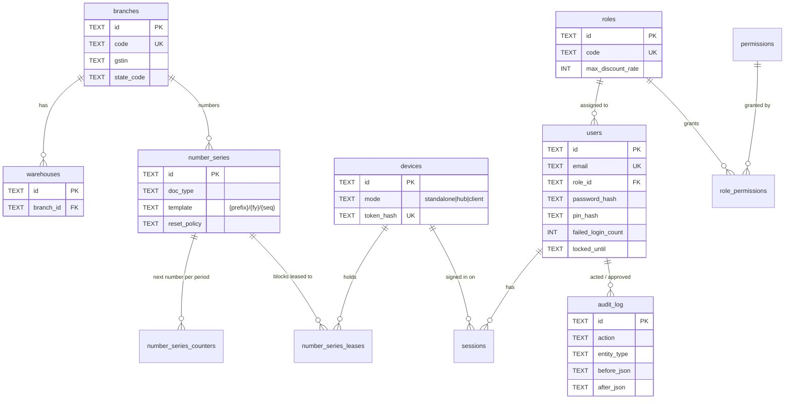
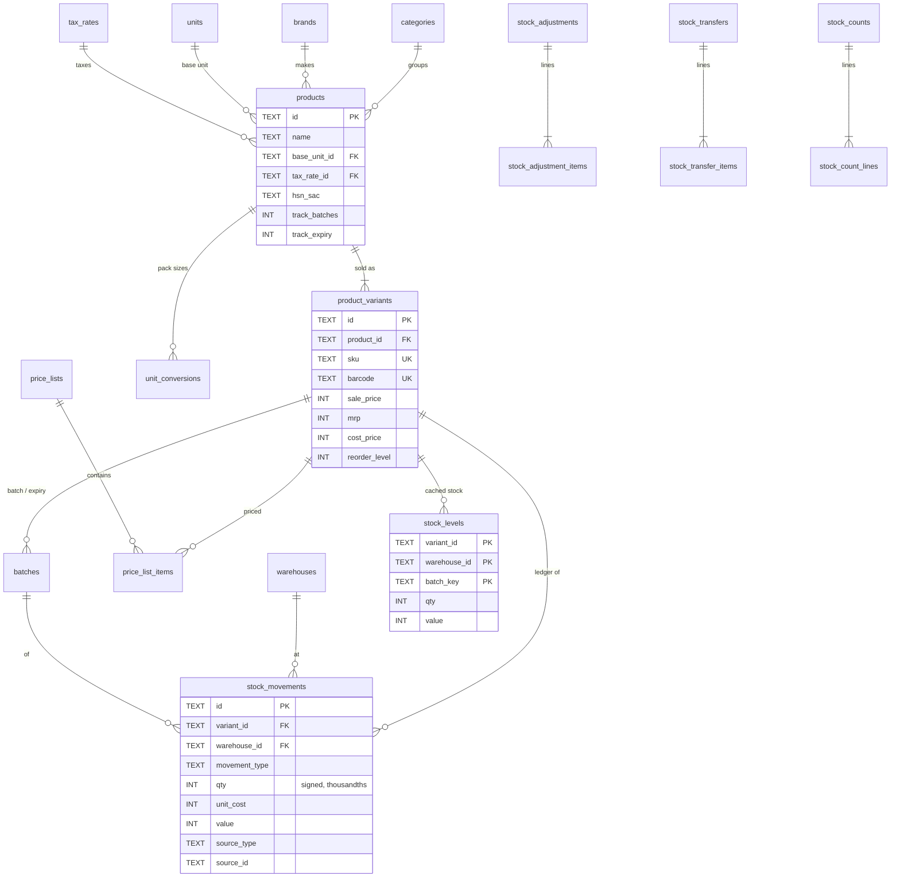
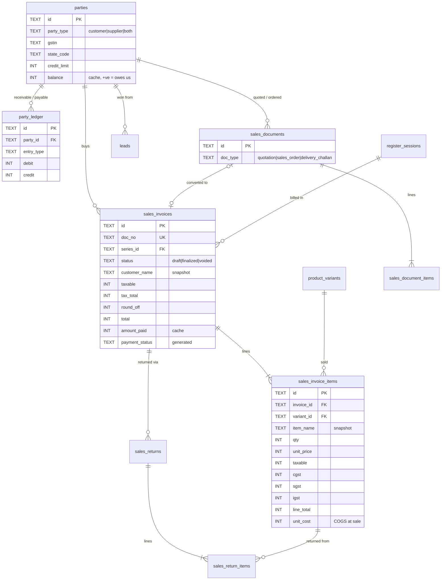
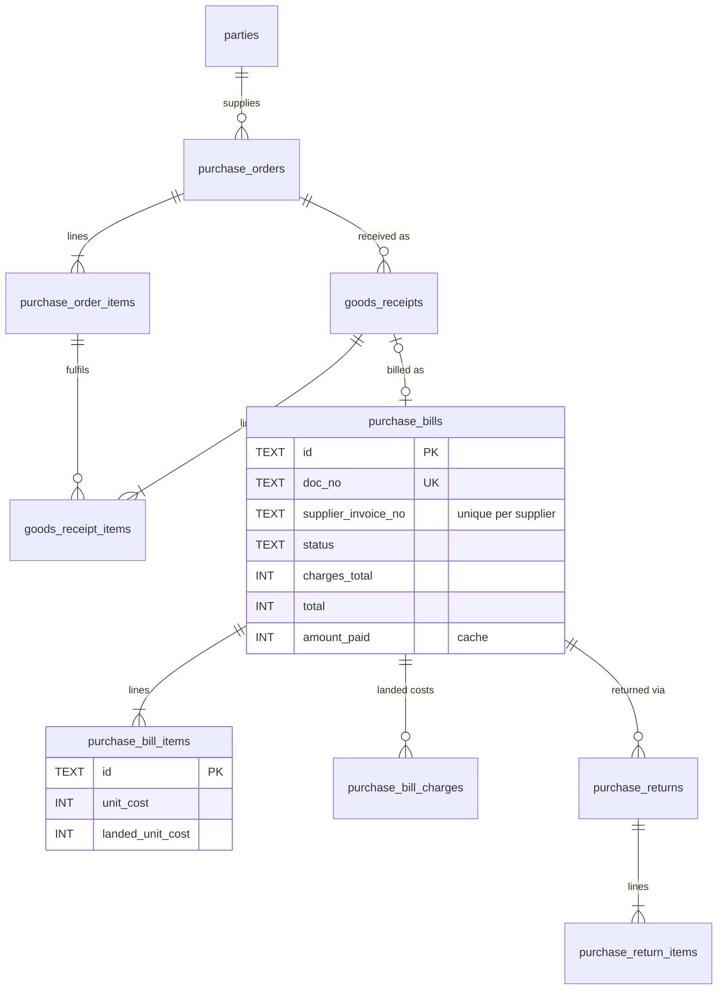
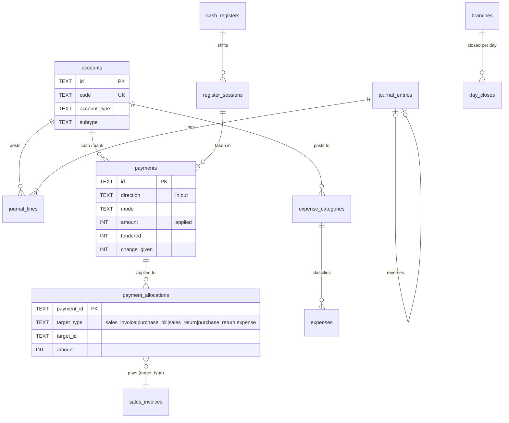

# Database (v2)

*Schema version 12 · SQLite (bundled 3.45, STRICT tables, WAL) · Source:
`src-tauri/src/db/migrations/*.sql` · Tests: `src-tauri/src/db/tests.rs`*

The v2 database replaces the v1 `inventory_app.db`. It is created by versioned migrations and
filled from v1 by the legacy migration (§7). Until Phase 3 moves the services over, the running
app still uses v1.

---

## 1. Design principles

1. **Ledgers are the truth, caches are checked.** Stock lives in `stock_movements`, receivables
   and payables in `party_ledger`, and money in `journal_lines`. `stock_levels`, `parties.balance`
   and the documents' `amount_paid` are caches that triggers keep in step, and views prove it
   (§5). A cache can always be rebuilt from its ledger (§8).
2. **Finalized means final.** Invoices, returns, bills, receipts, payments and expenses can't be
   edited or deleted once finalized. Triggers enforce this, not just the app. Corrections are
   voids, reversals and credit notes.
3. **History is a snapshot.** Document lines store the item name, SKU, HSN, unit, price, tax and
   cost *as they were*, and headers store the customer or supplier details. Editing a product or
   party never changes a past document.
4. **The database rejects bad data even if the app has a bug:** `CHECK` constraints, strict types,
   foreign keys and partial unique indexes.

## 2. Conventions

| Thing | Rule |
|---|---|
| Primary keys | `TEXT` UUID. New rows use **UUIDv7** (time-ordered). Migrated v1 rows keep their v4 ids. Seeded system rows use fixed ids (`01920000-…`). |
| Money | `INTEGER` **minor units** (paise). Never REAL: STRICT tables reject floats. |
| Quantities | `INTEGER` **thousandths** of the base unit (1.5 kg = 1500). |
| Rates (tax, discount) | `INTEGER` **parts per million** (18% = 180000, 0.25% = 2500). |
| Timestamps | `TEXT` RFC 3339 UTC (`created_at`, `finalized_at`, …). |
| Business dates | `TEXT 'YYYY-MM-DD'` in the business timezone (`business_date`). Reports group by this, never by the UTC timestamp. |
| Audit columns | Every business table has `created_at, updated_at, created_by, updated_by, deleted_at`. |
| Soft delete | `deleted_at IS NOT NULL`. Unique indexes are partial (`WHERE deleted_at IS NULL`), so a deleted SKU can be reused. |
| Booleans | `INTEGER CHECK (x IN (0, 1))`. |
| Enums | `TEXT` with a `CHECK (… IN (…))` list mirroring `packages/shared/src/constants.ts`. |
| Exceptions | Append-only ledgers (`stock_movements`, `party_ledger`, `journal_entries/lines`, `payment_allocations`, `audit_log`) have only `created_at/created_by`, because they are never updated or deleted. Line tables (`*_items`) have `created_at/updated_at` and inherit the rest from their header. |
| Rounding | Done in the services with the shared engine (`packages/shared/src/tax.ts`, Rust `domain::money`). Stored values are already rounded, so the database only checks that the sums are consistent. |

## 3. Entity-relationship diagrams

The schema is split into five diagrams for readability. Only keys and the most important columns
are shown.

### 3.1 Organisation, users and security



Also in this group: `settings` (one validated JSON row per settings section, versioned),
`idempotency_keys`, `sync_outbox` (client), `sync_log` (hub), `legacy_records` (archived v1 rows)
and `schema_migrations`.

### 3.2 Catalogue and stock



`product_variants` is the stock-keeping unit. A simple product has exactly one variant, so
everything that touches stock or prices references `variant_id`. `product_search` is an FTS5
index over name, SKU and barcode, maintained by triggers.

### 3.3 Parties and sales



Also: `held_bills` (parked POS carts; recalling one soft-deletes it so it can't be billed twice).

### 3.4 Purchases



### 3.5 Accounting and cash



Split payments at the till are several `payments` rows allocated to the same invoice. Cash
handed over beyond the bill is `tendered` and `change_given`, never "paid" (audit B-4).

### 3.6 Printing (migration 0010, Phase 9)

- `print_jobs`: documents sent to one of the hub's shared printers (the hub's print queue). The
  rendered job is kept in `data` (BLOB) so a retry sends the same bytes; `status` is `queued`,
  `printed`, `failed` or `cancelled`, with `attempts`, `last_error`, `error_kind` and
  `next_try_at` for the automatic retries. `printer_id` names a printer in the hub's
  `printers.json`, not a row. Printed and cancelled jobs are deleted after 7 days.
- `label_templates`: label size (mm), gap, labels across, barcode type and which fields show. Two
  templates are seeded.
- Permissions `printing.manage`, `labels.print`, `sales.open_drawer` and their role grants.

Printers and routes are **not** in the database: they are per PC (`printers.json`, ASSUMPTIONS
A-97).

### 3.7 Inventory depth (migration 0011, Phase 10)

- `cost_layers`: FIFO cost layers, one per receipt into an item, store and batch (`batch_key`),
  with `qty_in`, `qty_left`, `unit_cost` and the exact `value_left`; `movement_id` is the
  movement that created it. Only used while `inventory.valuationMethod` is `fifo`.
- `cost_layer_uses`: what each outgoing movement took from each layer (append-only).
- `price_lists.kind` (`retail`, `wholesale`, `custom`; existing lists become `custom`) and
  `notes`; `price_list_items.valid_from` / `valid_to` (dates, both optional); the unique index
  on list items now includes `valid_from`, so the same slab can have a later price.
- `cash_registers.price_list_id`: the till's price list.
- `sales_invoice_items.cost_value`: the exact cost the line was booked at (null on older sales).
- Permissions `price_lists.manage` (owner, manager) and `inventory.valuation` (owner).
- Batches stay in `batches` (0002); expiry settings live in the settings JSON.

### 3.8 Accounting depth (migration 0012, Phase 11)

- `manual_journals` and `manual_journal_lines`: reviewed journals (draft, submitted, approved,
  posted, reversed). Posting writes an ordinary `journal_entries` row (`source_type =
  'manual_journal'`) and sets `journal_entry_id`. Triggers: lines change only while the journal
  is a draft; a posted journal changes only to `reversed`; nothing is deleted. `reversal_of` and
  `reversed_by_journal` link a journal and its reversal; `allow_restricted` with
  `restricted_reason` and `restricted_by` is the owner's permission for control accounts.
- `attachments`: files on a record (`entity_type = 'manual_journal'`), stored in the
  `attachments` folder beside the database under `storage_key`.
- `day_closes.status` (`closed` or `reopened`) with `reopened_at`, `reopened_by`,
  `reopen_reason`.
- `fiscal_year_closes`: one row per close (status `closed` or `reopened`), with the closing
  `journal_entry_id` (`source_type = 'year_close'`) and the net profit moved to Retained Earnings
  (new system account 3100). At most one closed row per year start.
- `register_sessions.difference_reason` and `difference_approved_by`.
- `bank_statement_imports`, `bank_statement_lines` (positive = money in; `line_hash` unique per
  account; status `unmatched`, `matched` or `ignored`), `bank_matches` (a cleared journal line,
  with its statement line or ticked; soft-deleted when unmatched; one live match per journal
  line), `bank_import_profiles` (the column mapping per account), `bank_reconciliations`
  (append-only history).
- `cheques`: post-dated cheques (pending, cleared, bounced, cancelled) and the `payment_id`
  recorded when one clears. Never deleted.
- `report_views` (per user) and `report_schedules` (one live schedule per view).
- Permissions `journal.manage`, `journal.approve`, `journal.restricted`, `period.override`,
  `period.manage`, `audit.export`, `bank.reconcile` and their grants.
- Settings section `accounting` (`lockClosedDays`, `tillDifferenceApproval`, `bankMatchDays`).

## 4. Invariants the database enforces

| Rule | How |
|---|---|
| Money and quantities are integers | STRICT tables + `INTEGER` columns |
| `total = taxable + tax_total + round_off` (+ `charges_total` on bills); line `tax_total = cgst + sgst + igst + other_tax + cess`; `line_total = taxable + tax_total` | `CHECK` |
| A finalized or voided document can't change (header, lines, landed costs) or be deleted | `trg_*_lock`, `trg_*_items_{ins,upd,del}`, `trg_*_no_delete` |
| Status only moves forward: draft → finalized → voided | `trg_*_status` |
| A non-draft document has a number; numbers are unique; one sequence per series and period | `CHECK`, `ux_*_doc_no`, `ux_sales_invoices_seq` |
| Stock movements, party ledger, journal, allocations and audit log are append-only | `trg_*_no_update` / `trg_*_no_delete` |
| A movement's sign matches its type (a sale can't add stock) | `CHECK` on `stock_movements` |
| `stock_levels` = Σ movements; `parties.balance` = Σ ledger | AFTER INSERT triggers. Checked by views (§5) |
| An allocation targets an existing finalized document, in the right direction, within the payment's amount and the document's total | `trg_payment_allocations_check` + `CHECK (amount_paid BETWEEN 0 AND total)` |
| Voiding a payment releases what it paid | `trg_payments_void_release` |
| GST rates split evenly into CGST/SGST | `CHECK (tax_type <> 'gst' OR rate % 2 = 0)` |
| The same supplier invoice can't be entered twice | `ux_purchase_bills_supplier_invoice` |
| One default branch, one default warehouse per branch, one open session per register | partial unique indexes |
| JSON columns contain valid JSON | `CHECK (json_valid(...))` |

Errors raised by triggers start with a stable code (`DOCUMENT_FINALIZED`, `APPEND_ONLY`,
`INVALID_STATUS`, `INVALID_ALLOCATION`). The API maps them to `ApiError` codes.

## 5. Integrity views

| View | Must be empty? | Meaning |
|---|---|---|
| `v_stock_level_mismatches` | yes | cached stock ≠ ledger |
| `v_party_balance_mismatches` | yes | cached balance ≠ party ledger |
| `v_cost_layer_mismatches` | yes | under FIFO: open cost layers ≠ stock level (qty or value) for an item, store and batch |
| `v_unbalanced_journal_entries` | yes for v2 entries | debits ≠ credits (v1 entries that were already unbalanced are listed in the migration report) |

The weekly integrity job (Phase 4) runs these plus `PRAGMA quick_check` and reports, never "fixes".

## 6. Indexes from query patterns

| Query (where it's used) | Index |
|---|---|
| Barcode scan / SKU lookup at the POS (exact) | `ux_product_variants_barcode`, `ux_product_variants_sku`, `ux_unit_conversions_barcode` (pack barcodes) |
| Product search as you type | `product_search` (FTS5, prefix 2–3) |
| Stock card / stock on a date for one item | `ix_stock_movements_variant (variant_id, warehouse_id, business_date)` |
| What did this document do to stock? (void, audit) | `ix_stock_movements_source` |
| Stock movement report by date | `ix_stock_movements_date` |
| Sales register / day book / tax report by date | `ix_sales_invoices_date (business_date, status)`, `ix_purchase_bills_date`, `ix_payments_date`, `ix_expenses_date` |
| Customer ledger / statement | `ix_party_ledger_party (party_id, business_date)`, `ix_sales_invoices_party` |
| Receivables / payables (unpaid documents) | partial `ix_sales_invoices_receivable`, `ix_purchase_bills_payable` |
| Item-wise sales and profit | `ix_sales_invoice_items_variant` |
| Expiring items | partial `ix_batches_expiry` |
| Cash-up per shift | `ix_payments_session` |
| Audit trail of a record / of a user | `ix_audit_log_entity`, `ix_audit_log_user` |
| Session check on every request | `sessions.token_hash UNIQUE` |

Performance targets (Master Prompt §12) are benchmarked against a generated 50k-product,
one-year dataset in Phase 7. Indexes are adjusted from `EXPLAIN QUERY PLAN` results then, in new
migrations.

## 7. Migrating from v1

### How to run it

```bash
cargo run --manifest-path src-tauri/Cargo.toml --bin migrate-legacy -- --dry-run
```

```bash
cargo run --manifest-path src-tauri/Cargo.toml --bin migrate-legacy
```

Defaults: v1 is read from `%LOCALAPPDATA%\com.niyas.tauri-app\inventory_app.db`, v2 is written to
`inventory_v2.db` next to it, and backups and reports go to `backups\` next to it. Options:
`--legacy`, `--out`, `--backup-dir`, `--dry-run`, `--currency-digits`. Phase 3 runs the same code
automatically on the first start of the new version, after showing the dry-run report.

### What it does

1. Copies v1 with SQLite's online backup, runs `PRAGMA integrity_check` on the copy and records
   its SHA-256. **v1 itself is never opened for writing.**
2. Creates a **new** v2 file. It refuses to overwrite one, runs the migrations, then performs the
   whole transformation in **one transaction**.
3. Verifies the result before commit (stock and party caches). After commit it runs a foreign key
   check and an integrity check. On any failure the v2 file is deleted.
4. Writes `migration-report-<time>.json`: per-table counts, totals compared (sales, purchases,
   stock value, expenses), every amount that needed rounding, balance differences, negative stock,
   users who must change the default password, and warnings.

### Mapping

| v1 | v2 | Notes |
|---|---|---|
| every table except `sessions` | `legacy_records` | the full original row as JSON (password hashes removed) |
| `users` | `users` | `admin→owner`, `manager`, `accountant`, `staff→cashier`. Users still on the v1 default password get `must_change_password`. Case-only duplicate e-mails stop the migration with a message. |
| `sessions` | (dropped) | everyone signs in again |
| `categories`, `brands`, `units`, `tax_rates` | same | rate % → ppm. Names containing "GST" become `tax_type = 'gst'`. Case-only duplicate names are renamed and reported. |
| `products` | `products` + one `product_variants` row | `offer_price > 0` → sale price, with `price` as MRP. Expiry-tracked stock goes into batch `V1`. |
| `products.stock` | one `opening` stock movement | the v2 cache equals v1 stock exactly. v1 `stock_adjustments` are archived only (history). |
| `customers`, `suppliers` | `parties` | final balance = what v1 showed. Any difference from the migrated documents is posted as a flagged `opening` entry and listed. |
| `invoices` + `invoice_items` | `sales_invoices` + items (`snapshot_source = 'migrated'`) | v1 numbers kept (series "Migrated from v1"). Invoice tax and discount spread over lines so they add up. `Cancel` → voided. |
| invoice `amount_paid` | `payments` + `payment_allocations` | capped at the total; the excess is recorded as change given. Method `CREDIT`/unknown → `other`, reported. |
| `payments` (RECEIVE / PAY) | `payments` on account + party ledger | |
| `purchases` `RECEIVED` / other | `purchase_bills` (finalized) / `purchase_orders` (open) | |
| `quotations` | `sales_documents` (`quotation`) | |
| `expenses` | `expenses` + a cash `payment` allocated to each | category text → expense category (rent → 5100, others → 5200, as v1 posted) |
| `chart_of_accounts` | `accounts` | same code as a system account → mapped to it |
| `journal_entries/lines` | same, `source_type = 'legacy'` | two-sided v1 lines are netted. v1 entries that were already unbalanced are kept and reported. |
| `audit_logs` | `audit_log` | |
| `held_orders` | `held_bills` (`cart_format = 'legacy-v1'`) | |
| `leads` | `leads` | stage lower-cased |

Floats become minor units with JavaScript `Math.round` semantics, identical to the TS helper
(shared vectors in `packages/shared/test-vectors/money.json`). Any value that needed rounding
beyond float noise is listed in `lossy_amounts`.

## 8. Rebuilding caches (support procedure)

Only if an integrity view reports a mismatch. Run inside a transaction after a backup, and record
it in the audit log.

```sql
DELETE FROM stock_levels;
INSERT INTO stock_levels (variant_id, warehouse_id, batch_key, batch_id, qty, value, updated_at)
SELECT variant_id, warehouse_id, coalesce(batch_id, ''), batch_id, sum(qty), sum(value), datetime('now')
FROM stock_movements GROUP BY variant_id, warehouse_id, coalesce(batch_id, '');

UPDATE parties SET balance = (
  SELECT coalesce(sum(debit - credit), 0) FROM party_ledger WHERE party_id = parties.id);
```

## 9. Changing the schema

1. Add `src-tauri/src/db/migrations/NNNN_description.sql` and register it in `MIGRATIONS`
   (`db/migrate.rs`).
2. **Never edit a released migration.** Its checksum is verified on every start, and the app
   refuses to run against an edited one.
3. Add or extend tests in `db/tests.rs`. Keep enum `CHECK` lists in sync with
   `packages/shared/src/constants.ts`. A test compares the permission list.
4. A database from a newer app version is refused (`NewerThanApp`), so an old build can't damage it.
